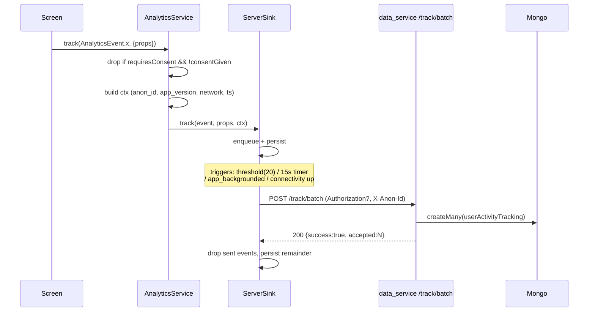

# SharePerks Flutter — Tracking Integration Guide

This is the complete, ready-to-execute guide for wiring the SharePerks Flutter
app to the new `/track` API in `data_service`. Follow the steps in order. It
covers everything the app team needs:

- which packages to add
- which files to drop in (full source already lives in `docs/flutter/`)
- which existing files to edit (with exact diffs against the real paths)
- a back-compat shim so the existing `UserActivityTrackingService` and
  `RouteAwareTrackingMixin` keep working while we migrate
- consent + privacy gates
- a per-funnel cheat-sheet of where to emit each event

The backend contract lives in
[`README.md`](../README.md) under **Tracking (user activity)**.

---

## Phase 0 — Add packages

In `application/pubspec.yaml`, add to `dependencies:` (everything else is
already in the project — `dio`, `shared_preferences`, `connectivity_plus`,
`package_info_plus`, `logger`):

```yaml
dependencies:
  # already present, no changes needed for tracking:
  # dio, shared_preferences, connectivity_plus, package_info_plus, logger
```

> The analytics package was authored to use only packages that already exist
> in `pubspec.yaml`. UUID generation uses `dart:math` + `dart:io` only —
> no new dependency required.

Optional later (when you add device-level details to `ctx`):

```yaml
dependencies:
  device_info_plus: ^11.0.0   # for os_version + device_model
```

---

## Phase 1 — Drop in the analytics package

Copy `docs/flutter/integrations/analytics/` from this repo into the Flutter
app at `application/lib/integrations/analytics/`. The simplest one-shot:

```bash
cp -R data_service/docs/flutter/integrations \
      application/lib/integrations
```

You now have:

```
application/lib/integrations/analytics/
├── analytics_service.dart
├── analytics_event.dart
├── analytics_context.dart
├── journey_context.dart
├── track_eligibility.dart
├── tracked_action.dart
├── anon_id.dart
├── session_id.dart
├── consent_manager.dart
├── route_observer.dart
├── sinks/
│   ├── analytics_sink.dart
│   ├── debug_sink.dart
│   └── server_sink.dart
└── README.md
```

Read [`integrations/analytics/README.md`](flutter/integrations/analytics/README.md)
for the event quick-reference.

---

## Phase 2 — Initialise in `main.dart`

Edit [`application/lib/main.dart`](../../application/lib/main.dart).

**2.1 — add imports:**

```dart
import 'package:shareperks/integrations/analytics/analytics_service.dart';
import 'package:shareperks/integrations/analytics/analytics_event.dart';
```

**2.2 — initialise before `runApp`:**

Replace the existing `void main(...)` opening with:

```dart
void main(List<String> args) async {
  WidgetsFlutterBinding.ensureInitialized();

  // Analytics: must init before runApp so app_opened captures cold-start.
  await AnalyticsService.instance.init(
    trackingApiBaseUrl: 'https://listing.shareperks.in',
    getAuthToken: () async {
      final prefs = await SharedPreferences.getInstance();
      return prefs.getString('token');
    },
  );
  AnalyticsService.instance.track(AnalyticsEvent.appOpened);

  ScgatewayFlutterPlugin.setConfigEnvironment(/* ...existing... */);
  // ...rest of existing main() unchanged...
}
```

> `SharedPreferences` is already imported in `main.dart`.

**2.3 — lifecycle hooks (`_MyAppState.didChangeAppLifecycleState`):**

Inside the existing switch, append:

```dart
@override
void didChangeAppLifecycleState(AppLifecycleState state) {
  switch (state) {
    case AppLifecycleState.resumed:
      _isAppInForeground = true;
      _startSessionHeartbeat();
      AnalyticsService.instance.track(AnalyticsEvent.appForegrounded);
      break;
    case AppLifecycleState.inactive:
    case AppLifecycleState.paused:
    case AppLifecycleState.detached:
    case AppLifecycleState.hidden:
      _isAppInForeground = false;
      _stopSessionHeartbeat();
      AnalyticsService.instance.track(AnalyticsEvent.appBackgrounded);
      // Best-effort flush before the OS suspends us.
      AnalyticsService.instance.flush();
      break;
  }
}
```

**2.4 — connectivity loss event:**

Inside the existing `_checkSession` connectivity branch, right after
`if (!_hasNetworkConnection(connectivity))`:

```dart
if (!_hasNetworkConnection(connectivity)) {
  AnalyticsService.instance.track(AnalyticsEvent.connectivityLost);
  // ...rest unchanged...
}
```

---

## Phase 3 — Swap the global `routeObserver` for the analytics-aware one

Edit [`application/lib/utils/navigation.dart`](../../application/lib/utils/navigation.dart):

```diff
 import 'package:flutter/material.dart';
 import 'package:logger/logger.dart';
+import 'package:shareperks/integrations/analytics/route_observer.dart';

 export 'app_routes.dart';

 Logger logger = Logger();
 final GlobalKey<NavigatorState> navigationKey = GlobalKey<NavigatorState>();

-/// Used with [RouteAwareTrackingMixin] for automatic screen_view tracking.
-final RouteObserver<PageRoute<dynamic>> routeObserver =
-    RouteObserver<PageRoute<dynamic>>();
+/// Used with [RouteAwareTrackingMixin] for legacy screen_view tracking AND
+/// with the new AnalyticsService (auto-emits screen_view on push/replace).
+final AnalyticsRouteObserver<PageRoute<dynamic>> routeObserver =
+    AnalyticsRouteObserver<PageRoute<dynamic>>();
```

That is the only change needed. `AnalyticsRouteObserver` extends
`RouteObserver<PageRoute<dynamic>>` so every existing screen that uses
`RouteAwareTrackingMixin` (HomeScreen, OfferScreen, WalletScreen, …) keeps
working **unchanged**.

> `MaterialApp.navigatorObservers: [routeObserver]` is already wired in
> `_MyAppState.build` — no further change needed there.

---

## Phase 4 — Identify the user (auth wiring)

Edit [`application/lib/network/services/Auth.service.dart`](../../application/lib/network/services/Auth.service.dart).

**4.1 — emit OTP funnel events:**

```dart
import 'package:shareperks/integrations/analytics/analytics_service.dart';
import 'package:shareperks/integrations/analytics/analytics_event.dart';

class AuthService {
  static Future<void> sendOtp(String mobileNumber) async {
    AnalyticsService.instance.track(AnalyticsEvent.loginStarted);
    final response = await dio.post(
      '/model/user/auth/mobile_otp/send-otp',
      data: {'mobile': mobileNumber},
    );
    AnalyticsService.instance.track(AnalyticsEvent.otpSent);
    return response.data;
  }

  static Future<void> verifyOtp(String mobileNumber, String otp) async {
    SharedPreferences prefs = await SharedPreferences.getInstance();
    try {
      final response = await dio.post(
        '/model/user/auth/mobile_otp/verify-otp',
        data: {'mobile': mobileNumber, 'otp': otp},
      );
      prefs.setString('token', response.data['token']);
      // Identify so subsequent events carry the JWT.
      final userId = response.data['user']?['id'] as String? ?? '';
      if (userId.isNotEmpty) {
        AnalyticsService.instance.identify(userId);
      }
      AnalyticsService.instance.track(AnalyticsEvent.otpVerified);
      return response.data;
    } catch (e) {
      AnalyticsService.instance.track(AnalyticsEvent.otpFailed, {
        'reason': e.toString(),
      });
      rethrow;
    }
  }

  static Future<void> resendOtp(String mobileNumber) async {
    final response = await dio.post(
      '/model/user/auth/mobile_otp/resend-otp',
      data: {'mobile': mobileNumber},
    );
    AnalyticsService.instance.track(AnalyticsEvent.otpResent);
    return response.data;
  }

  static Future<void> completeProfile(
    String name,
    String email,
    String? referCode,
  ) async {
    SharedPreferences prefs = await SharedPreferences.getInstance();
    String token = prefs.getString('token') ?? '';
    final response = await dio.patch(
      '/user/profile/complete',
      data: {'name': name, 'email': email, 'referCode': referCode},
      options: Options(headers: {'Authorization': 'Bearer $token'}),
    );
    AnalyticsService.instance.track(AnalyticsEvent.profileCompleted, {
      if (referCode != null && referCode.isNotEmpty) 'referred_by': referCode,
    });
    AnalyticsService.instance.track(AnalyticsEvent.signupCompleted);
    return response.data;
  }
}
```

**4.2 — reset on logout:**

Edit [`application/lib/provider/UserData.provider.dart`](../../application/lib/provider/UserData.provider.dart):

```diff
+import 'package:shareperks/integrations/analytics/analytics_service.dart';
+import 'package:shareperks/integrations/analytics/analytics_event.dart';

 class UserDataProvider extends ChangeNotifier {
   ...
   /// Clears session and resets connection state. Call on logout.
   void clearSession() {
+    AnalyticsService.instance.track(AnalyticsEvent.logout);
+    AnalyticsService.instance.reset();
     _userSession = null;
     _isSmallcaseConnected = false;
     _totalUnlockerReward = 0;
     _newUnlockedRewardThisWeek = 0;
     notifyListeners();
   }
```

**4.3 — restore identity on session restore** (wherever you call
`AuthService.me()` to verify the saved token, e.g. in `SplashScreen`):

```dart
final session = await AuthService.me();
if (session?.user?.id != null) {
  AnalyticsService.instance.identify(session!.user!.id);
}
```

---

## Phase 5 — Back-compat shim: keep `UserActivityTrackingService` working

The existing `lib/network/services/UserActivityTrackingService.dart` is wired
into ~20 screens (every screen that uses `RouteAwareTrackingMixin`). Instead of
touching every one of them, replace just the `track()` body so it routes
through the new `AnalyticsService`. Existing screens keep working — they just
start landing in the new pipeline.

Replace the file contents with:

```dart
import 'package:flutter/material.dart';
import 'package:provider/provider.dart';
import 'package:shareperks/integrations/analytics/analytics_event.dart';
import 'package:shareperks/integrations/analytics/analytics_service.dart';

/// LEGACY surface. Keep using this for ad-hoc tracking, but for new code
/// prefer `AnalyticsService.instance.track(AnalyticsEvent.<typed>, {...})`
/// directly. This class now forwards into the same pipeline.
class UserActivityTrackingService {
  Future<bool> track({
    required String type,
    required String description,
    String? value,
  }) async {
    try {
      final event = AnalyticsEvent.custom(
        _safeName(type),
        category: 'custom',
        requiresConsent: false,
      );
      await AnalyticsService.instance.track(event, {
        'legacy_type': type,
        'legacy_description': description,
        if (value != null && value.isNotEmpty) 'legacy_value': value,
      });
      return true;
    } catch (_) {
      return false;
    }
  }

  Future<Map<String, dynamic>?> fetchActivity({
    int limit = 20,
    int skip = 0,
  }) async {
    // /track/me/recent does not paginate by skip; consume via limit only.
    // For richer admin views, talk to the data_service directly.
    return null;
  }

  String _safeName(String raw) {
    final cleaned = raw
        .toLowerCase()
        .replaceAll(RegExp(r'[^a-z0-9]+'), '_')
        .replaceAll(RegExp(r'^_+|_+$'), '');
    if (cleaned.isEmpty) return 'legacy_event';
    return cleaned.length > 80 ? cleaned.substring(0, 80) : cleaned;
  }
}

void trackEvent(
  BuildContext context,
  String type,
  String description, [
  String? value,
]) {
  try {
    final service = context.read<UserActivityTrackingService>();
    service.track(type: type, description: description, value: value).then((_) {});
  } catch (_) {}
}
```

Result: every existing `_trackingService.track(type: 'screen_view', ...)`
call in `RouteAwareTrackingMixin` now lands as
`AnalyticsEvent.custom('screen_view', ...)` on the new server. You can
incrementally migrate hot screens to the typed `AnalyticsEvent.xxx`
constants over time.

---

## Phase 6 — Dio interceptor for `api_call` / `api_error`

Edit [`application/lib/network/client.dart`](../../application/lib/network/client.dart) to attach
an interceptor:

```dart
import 'package:dio/dio.dart';
import 'package:shareperks/integrations/analytics/analytics_service.dart';
import 'package:shareperks/integrations/analytics/analytics_event.dart';

const String kBackendBaseUrl = 'https://backend-api.shareperks.in';

final dio = Dio(
  BaseOptions(
    baseUrl: '$kBackendBaseUrl/api',
    headers: {'Content-Type': 'application/json'},
  ),
)..interceptors.add(InterceptorsWrapper(
    onRequest: (options, handler) {
      options.extra['_t0'] = DateTime.now().millisecondsSinceEpoch;
      handler.next(options);
    },
    onResponse: (response, handler) {
      final t0 = response.requestOptions.extra['_t0'] as int?;
      final latency = t0 != null
          ? DateTime.now().millisecondsSinceEpoch - t0
          : null;
      AnalyticsService.instance.track(AnalyticsEvent.apiCall, {
        'endpoint': response.requestOptions.path,
        'method': response.requestOptions.method,
        'status': response.statusCode,
        if (latency != null) 'latency_ms': latency,
      });
      handler.next(response);
    },
    onError: (error, handler) {
      AnalyticsService.instance.track(AnalyticsEvent.apiError, {
        'endpoint': error.requestOptions.path,
        'method': error.requestOptions.method,
        'status': error.response?.statusCode,
        'message': error.message,
        'type': error.type.name,
      });
      handler.next(error);
    },
  ));
```

The interceptor must NEVER block requests — every callback synchronously
forwards via `handler.next(...)`. `AnalyticsService.instance.track` is
fire-and-forget.

---

## Phase 7 — Funnel events (per-screen wiring)

For each screen below, add one `import` and the indicated `track(...)` call.
All calls are fire-and-forget; you do not need to `await` them.

### 7.1 Giftcard / credit funnel — the revenue path

`application/lib/screens/main/credit/*` + `application/lib/modules/cashfree/`:

| Screen | Place | Event |
|--------|-------|-------|
| `CreditInfoScreen` | mount | `AnalyticsEvent.giftcardPerkViewed` with `{credit_id, brand_id, perk_type:'giftcard'}` |
| `CreditInfoScreen` | after eligibility check | `AnalyticsEvent.giftcardEligibilityChecked` with `{credit_id, eligible:true|false}` |
| `CreditPaymentSummaryScreen` | mount | `AnalyticsEvent.giftcardAmountScreenViewed` with `{credit_id}` |
| `CreditPaymentSummaryScreen` | user picks amount | `AnalyticsEvent.giftcardAmountSelected` with `{amount, denomination_type}` |
| `CashfreePaymentService` (`lib/modules/cashfree/`) | when session created | `AnalyticsEvent.giftcardPaymentInitiated` with `{cashfree_order_id, amount, currency:'INR'}` |
| Cashfree success callback | | `AnalyticsEvent.giftcardPaymentSucceeded` with `{cashfree_order_id, amount, currency:'INR', credit_id, brand_id}` |
| Cashfree failure callback | | `AnalyticsEvent.giftcardPaymentFailed` with `{cashfree_order_id, reason, error_code}` |
| `CreditOrderErrorScreen` "Retry" CTA | tap | `AnalyticsEvent.giftcardPaymentRetried` |
| `ViewGiftCardScreen` | mount | `AnalyticsEvent.giftcardRedeemedCodeViewed` |
| Code-copy button | tap | `AnalyticsEvent.giftcardCodeCopied` |

### 7.2 Cashback

| Screen | Event |
|--------|-------|
| `OfferScreen` | `AnalyticsEvent.cashbackPerkViewed` with `{reward_id}` |
| `ReadInfoHtmlPage` for terms | `AnalyticsEvent.cashbackTermsRead` with `{content_id}` |
| "Claim cashback" CTA | `AnalyticsEvent.cashbackClaimStarted` |
| Server returns 200 + redirect URL | `AnalyticsEvent.cashbackClaimCompleted` |

### 7.3 Promocode

| Screen | Event |
|--------|-------|
| `BenefitsScreen` (promocode variant) | `AnalyticsEvent.promocodePerkViewed` |
| "Reveal code" tap | `AnalyticsEvent.promocodeRevealed` |
| "Copy" tap | `AnalyticsEvent.promocodeCopied` |

### 7.4 Demat / holdings

`application/lib/modules/smallcase.dart`, `holding-satement.dart`, and
`ViewHoldingsScreen.dart`:

| Place | Event |
|-------|-------|
| Link-demat info screen mount | `AnalyticsEvent.linkDematStarted` |
| Broker list mount | `AnalyticsEvent.brokerListViewed` |
| Broker tap | `AnalyticsEvent.brokerSelected` with `{broker_id}` |
| `Scgateway.connect(...)` invocation | `AnalyticsEvent.smallcaseGatewayOpened` |
| Smallcase success callback | `AnalyticsEvent.smallcaseGatewaySuccess` |
| Smallcase failure callback | `AnalyticsEvent.smallcaseGatewayFailed` with `{reason}` |
| `holding-satement.dart` upload success | `AnalyticsEvent.holdingStatementUploaded` with `{file_size, broker_name}` |
| When holdings list is populated | `AnalyticsEvent.holdingsSynced` with `{num_holdings}` |

### 7.5 Wallet / payout

`application/lib/screens/main/wallet/*`:

| Screen | Event |
|--------|-------|
| `WalletScreen` mount | `AnalyticsEvent.walletViewed` with `{balance}` (or bucketed) |
| `TransferHistoryScreen` mount | `AnalyticsEvent.earningViewed` |
| `WalletHistoryScreen` mount | `AnalyticsEvent.walletHistoryViewed` |
| `WithdrawInfoScreen` mount | `AnalyticsEvent.payoutStarted` with `{amount}` |
| Submit payout request | `AnalyticsEvent.payoutRequestSubmitted` with `{amount, method:'upi'}` |
| `PayOutSuccessScreen` mount | `AnalyticsEvent.payoutSucceeded` with `{amount, txn_id?}` |
| `PayoutFailedScreen` mount | `AnalyticsEvent.payoutFailed` with `{amount, reason}` |

### 7.6 Referral

`application/lib/screens/main/ReferAndEarn/*`:

| Place | Event |
|-------|-------|
| `ReferAndEarnScreen` mount | `AnalyticsEvent.referScreenViewed` with `{referral_code}` |
| "Copy code" tap | `AnalyticsEvent.referCodeCopied` |
| Share-sheet tap | `AnalyticsEvent.referShareIntent` with `{channel:'whatsapp'|'sms'|'system'}` |

### 7.7 Errors

You already have a global `print` for Dio errors. Add:

```dart
// somewhere in main(), after WidgetsFlutterBinding.ensureInitialized():
FlutterError.onError = (details) {
  FlutterError.presentError(details);
  AnalyticsService.instance.track(AnalyticsEvent.appError, {
    'message': details.exceptionAsString(),
    'library': details.library,
  });
};
PlatformDispatcher.instance.onError = (error, stack) {
  AnalyticsService.instance.track(AnalyticsEvent.appError, {
    'message': error.toString(),
  });
  return true;
};
```

(`PlatformDispatcher` is from `dart:ui`.)

---

## Phase 8 — Consent gate (India DPDP / GDPR)

The architecture doc requires a first-launch consent sheet for the new
typed events. `requiresConsent: false` events (crash, payment, security)
keep firing regardless.

**8.1 — show the sheet from `SplashScreen` (or wherever the user first lands):**

```dart
import 'package:shareperks/integrations/analytics/consent_manager.dart';
import 'package:shareperks/integrations/analytics/analytics_service.dart';

Future<void> _maybeAskConsent(BuildContext context) async {
  final state = await ConsentManager.read();
  if (state != ConsentState.unknown) return;
  if (!context.mounted) return;

  final granted = await showModalBottomSheet<bool>(
    context: context,
    isDismissible: false,
    enableDrag: false,
    builder: (ctx) => Padding(
      padding: const EdgeInsets.all(20),
      child: Column(
        mainAxisSize: MainAxisSize.min,
        crossAxisAlignment: CrossAxisAlignment.start,
        children: [
          const Text(
            'Help us improve SharePerks',
            style: TextStyle(fontSize: 18, fontWeight: FontWeight.w600),
          ),
          const SizedBox(height: 8),
          const Text(
            'We use anonymous usage data to personalise perks and measure '
            'how you discover SharePerks. You can change this any time in '
            'Settings.',
          ),
          const SizedBox(height: 16),
          Row(
            children: [
              Expanded(
                child: OutlinedButton(
                  onPressed: () => Navigator.pop(ctx, false),
                  child: const Text('Not now'),
                ),
              ),
              const SizedBox(width: 12),
              Expanded(
                child: FilledButton(
                  onPressed: () => Navigator.pop(ctx, true),
                  child: const Text('Allow'),
                ),
              ),
            ],
          ),
        ],
      ),
    ),
  );

  if (granted == true) {
    await ConsentManager.grant();
  } else {
    await ConsentManager.deny();
  }
  AnalyticsService.instance.onConsentChanged(granted == true);
}
```

Call `_maybeAskConsent(context)` from `SplashScreen.didChangeDependencies`
(after the first frame, before navigation).

**8.2 — settings toggle:**

In `SettingsAndSecurityScreen`, add a switch tile bound to:

```dart
final granted = await ConsentManager.isGranted();
// ... onChanged:
if (newValue) {
  await ConsentManager.grant();
} else {
  await ConsentManager.deny();
}
AnalyticsService.instance.onConsentChanged(newValue);
```

**8.3 — iOS App Tracking Transparency (ATT):**

Defer until you add a marketing pixel (Meta / TikTok). The current
`ServerSink` does not need the Ad ID, so ATT can stay un-prompted in v1.

---

## Phase 9 — Verification checklist

1. `bun run dev` the data_service. Hit:
   ```bash
   curl -sX POST http://localhost:3004/track \
     -H 'Content-Type: application/json' \
     -H 'X-Anon-Id: 11111111-1111-4111-8111-111111111111' \
     -d '{"name":"app_opened","type":"lifecycle"}'
   ```
   → expect `{"success":true}`.
2. `flutter run` the app, watch the console for `[analytics] lifecycle/app_opened ...`
   from `DebugSink`.
3. After OTP login, request:
   ```bash
   curl -sH "Authorization: Bearer <jwt>" \
     http://localhost:3004/track/me/recent?limit=20 | jq
   ```
   → expect your last 20 events including `screen_view`, `otp_sent`,
     `otp_verified`, etc.
4. Toggle the consent switch off in Settings → emit a non-revenue event from
   any screen → it should NOT appear in `/track/me/recent`.

---

## Phase 10 — Journey correlation and screen exit

Copy new files from the reference package:

- `journey_context.dart`
- `track_eligibility.dart`
- `tracked_action.dart`

Ensure `AnalyticsRouteObserver` is wired (Phase 3). It now emits:

- `screen_view` on enter (`didPush`, `didReplace`, `didPopNext`)
- `screen_exit` on leave (`didPop`, `didPushNext`, `replace`) with `time_on_screen_ms`

**10.1 — Start journey on perk tap:**

```dart
JourneyContext.startJourney(rewardId: reward.id, perkType: 'giftcard');
trackAction(AnalyticsEvent.perkCardClicked, {
  'reward_id': reward.id,
  'perk_type': 'giftcard',
  'source': 'home',
  'position': index,
});
```

**10.2 — Eligibility helper:**

```dart
await trackEligibility(
  perkType: 'giftcard',
  rewardId: rewardId,
  isEligible: eligible,
  reason: 'no_holdings', // or ok | expired | min_qty
  source: 'reward_detail',
  brandId: brandId,
);
```

**10.3 — Enriched app background:**

```dart
case AppLifecycleState.paused:
  AnalyticsService.instance.track(
    AnalyticsEvent.appBackgrounded,
    AnalyticsService.instance.backgroundProps(),
  );
  AnalyticsService.instance.flush();
  break;
```

**10.4 — Pass `journey_id` to payment API:**

```dart
await dio.post('/payment/giftcard/proceed', data: {
  'payAmount': amount,
  'rewardAmount': rewardAmount,
  'creditId': creditId,
  'eligible': eligible,
  'journey_id': JourneyContext.currentJourneyId,
});
```

Screen wiring details: [`docs/flutter/instrumentation/p0-revenue-funnels.md`](flutter/instrumentation/p0-revenue-funnels.md).

---

## Phase 11 — Discovery and secondary funnels

Wire P1/P2 screens per [`docs/flutter/instrumentation/p1-p2-screens.md`](flutter/instrumentation/p1-p2-screens.md):

- `brand_viewed`, `cashback_*`, `funnel:wallet`, `funnel:demat`
- `voting_brand_selected`, `refer_*`, `push_opened`
- Dio interceptor for `api_call` / `api_error`

Disable duplicate `screen_view` from `RouteAwareTrackingMixin` once
`AnalyticsRouteObserver` is live.

---

## Reference — write-path sequence



---

## FAQ

**Why a facade?** So adding Firebase / AppsFlyer / CleverTap later is a
1-file change. Screens never import vendor SDKs.

**Why batch + offline queue?** Mobile users go offline; events that drop on
the floor are gone forever. The 500-cap persisted queue trades a little
SharedPreferences IO for not losing the entire user session on a flaky
network.

**Why optional JWT?** Pre-login funnel (`landing_viewed`, `otp_sent`,
`otp_failed`) is the highest-value funnel of any consumer app. The server
keys those events by `X-Anon-Id`. After login, the JWT takes over and the
warehouse stitches both sides via `anon_id` inside `value.ctx`.

**Why `value` JSON in Mongo?** We deliberately kept the schema untouched.
The 4-content-field layout (`name`, `type`, `description`, `value`) is enough
for v1. If query patterns require it later, add a typed `events` collection
and dual-write.

**Why does `UserActivityTrackingService` still exist?** Twenty existing
screens use it via `RouteAwareTrackingMixin`. The shim in Phase 5 routes
them through the new pipeline so we get value immediately without
touching every screen — migrate to typed `AnalyticsEvent.xyz` as you
visit each screen for other reasons.
