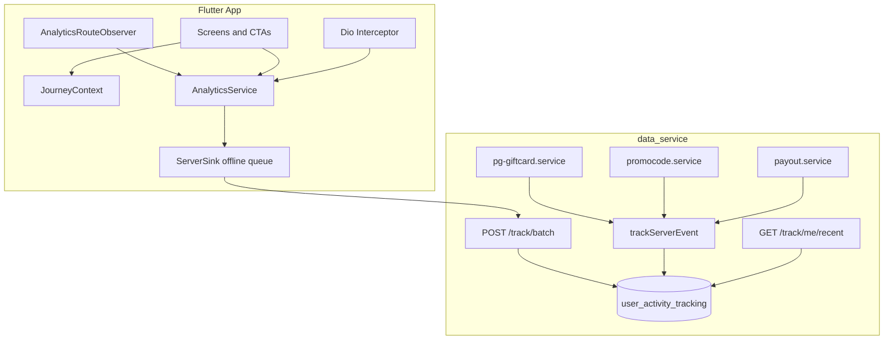

# SharePerks User Audit System

**Version:** 1.2.0  
**Last updated:** 2026-07-08  
**Owner:** Platform / Mobile / Backend

This document is the single source of truth for SharePerks user activity auditing — how we record what users do in the app, why they leave, and where funnels break.

---

## Table of contents

1. [Purpose and scope](#1-purpose-and-scope)
2. [Architecture](#2-architecture)
3. [Identity model](#3-identity-model)
4. [Event taxonomy](#4-event-taxonomy)
5. [Journey correlation](#5-journey-correlation)
6. [Screen audit map](#6-screen-audit-map)
7. [Exit and drop-off signals](#7-exit-and-drop-off-signals)
8. [Backend API contract](#8-backend-api-contract)
9. [Server-side event catalog](#9-server-side-event-catalog)
10. [Support playbook](#10-support-playbook)
11. [Privacy and consent](#11-privacy-and-consent)
12. [Changelog](#12-changelog)

---

## 1. Purpose and scope

### What this system is

A **first-party user activity audit trail** that records:

- Screen navigation (enter + exit with dwell time)
- Meaningful user actions (perk taps, eligibility checks, payments)
- Errors correlated with user context
- Authoritative server-side outcomes for revenue events

### What this system is NOT

| System | Collection / module | Purpose |
|--------|---------------------|---------|
| Financial ledger | `WalletTransaction`, `TransactionHistory` | Money in/out |
| Payment gateway audit | `PaymentTransactions.gatewayResponse` | Raw Cashfree JSON |
| Affiliate tracking | `/cashback/tracking-link` | Merchant click-through URLs |
| Admin audit log | *(not implemented)* | Cross-user admin actions |

Do not confuse user journey analytics with financial records. Use both when debugging payment issues.

---

## 2. Architecture



### Core principles

1. **Screens never call vendor SDKs** — only `AnalyticsService.instance`.
2. **No string-literal event names** — only `AnalyticsEvent.*` constants.
3. **Client + server tracking** — client for UX journey; server for revenue truth.
4. **Every funnel event carries context** — `journey_id`, `reward_id`, `perk_type`, `source`.
5. **Consent-gated** — marketing/discovery events wait for consent; payment/crash events do not.

### Package layout (Flutter)

```
lib/integrations/analytics/
├── analytics_service.dart
├── analytics_event.dart
├── analytics_context.dart
├── journey_context.dart       # journey + entity name correlation
├── screen_session.dart        # CRM card accumulator (one card per visit)
├── track_eligibility.dart     # eligibility helper
├── tracked_action.dart        # trackAction / trackButtonClick / trackBottomSheet
├── route_observer.dart
├── anon_id.dart
├── session_id.dart
├── consent_manager.dart
└── sinks/
    ├── server_sink.dart
    └── debug_sink.dart
```

Reference implementation: [`docs/flutter/integrations/analytics/`](flutter/integrations/analytics/).

Integration guide: [`docs/flutter-tracking-integration.md`](flutter-tracking-integration.md).

---

## 3. Identity model

| ID | Scope | Storage | Purpose |
|----|-------|---------|---------|
| `anon_id` | Device lifetime | SharedPreferences + `X-Anon-Id` header | Pre-login stitching |
| `session_id` | Cold start | In-memory timestamp | Group events in one app session |
| `userId` | Account | JWT `Authorization` header | Authenticated identity |
| `journey_id` | Single redemption attempt | In-memory + event props | Stitch funnel across screens |

### Stitching pre-login → post-login

1. Pre-login events: `userId = null`, `ctx.anon_id` set.
2. After OTP verify: call `AnalyticsService.instance.identify(userId)`.
3. Warehouse query: match `anon_id` in `value.ctx` for anonymous rows, `userId` for authenticated rows.

---

## 4. Event taxonomy

All event names MUST match `^[a-z][a-z0-9_]*$` (max 80 chars). Categories MUST match server `eventCategoryEnum`.

### Lifecycle

| Event | Category | Consent required | Key props |
|-------|----------|------------------|-----------|
| `app_opened` | lifecycle | No | `is_first_open`, `from_deeplink` |
| `app_foregrounded` | lifecycle | No | `paused_for_ms` |
| `app_backgrounded` | lifecycle | No | `last_screen`, `last_action`, `journey_id` |
| `screen_view` | screen | Yes | `screen_name`, `previous_screen`, `journey_id` |
| `screen_session` | screen | Yes | `screen_name`, `name`, `time_label`, `duration_ms`, `clicks_summary`, `clicks`, `journey_id` |
| `button_clicked` | engagement | Yes | `label`, `detail`, `screen_name`, `journey_id` |
| `deeplink_opened` | lifecycle | Yes | `url`, `path` |
| `connectivity_lost` | lifecycle | No | — |
| `route_blocked` | lifecycle | No | `reason` |

### Auth

| Event | When |
|-------|------|
| `landing_viewed` | Landing screen mount |
| `login_started` | User taps login |
| `otp_sent` / `otp_resent` / `otp_verified` / `otp_failed` | OTP flow |
| `profile_setup_started` / `profile_completed` / `signup_completed` | Profile setup |
| `logout` | Session cleared |

### Discovery

| Event | Key props |
|-------|-----------|
| `home_loaded` | `latency_ms`, `is_error` |
| `perk_card_clicked` | `reward_id`, `perk_type`, `position`, `source`, `journey_id` |
| `brand_viewed` | `brand_id`, `source` |
| `category_viewed` | `category_id` |
| `company_viewed` | `company_id` |
| `perk_eligibility_checked` | `reward_id`, `perk_type`, `is_eligible`, `eligibility_reason`, `source` |
| `voting_brand_selected` | `brand_id`, `is_revote` |

### Gift card funnel

```text
giftcard_perk_viewed
  → giftcard_eligibility_checked { is_eligible, eligibility_reason }
    → giftcard_amount_screen_viewed
      → giftcard_amount_selected { amount }
        → giftcard_payment_initiated { gift_card_name, face_value, amount, is_eligible }
          → giftcard_payment_order_created { cashfree_order_id, ...purchase }
            → giftcard_checkout_opened { payment_gateway: cashfree, cashfree_order_id }
              → giftcard_payment_succeeded ✓ (revenue) { cashfree_order_id, order_status, claimed_id, ...purchase }
              → giftcard_payment_failed { failure_stage, reason, cashfree_order_id }
              → giftcard_payment_cancelled { reason: user_cancelled_checkout }
          → giftcard_payment_abandoned (client, on screen dispose)
giftcard_redeemed_code_viewed → giftcard_code_copied
```

Every payment gateway event carries the **purchase context** (what the user is
buying): `payment_gateway` (`cashfree`), `gift_card_name`, `brand_name`,
`reward_id`, `face_value`, `amount` (paid), `discount_percent`, `savings`,
`is_eligible`. Success/failure additionally carry `cashfree_order_id` and
`order_status`. `giftcard_payment_succeeded` is emitted client-side at gateway
confirmation (`_handleCashfreeVerify`) — not on the success screen — so it
always fires with full context while the journey is still active.

### Promocode funnel

```text
promocode_perk_viewed
  → promocode_eligibility_checked { is_eligible, eligibility_reason }
    → promocode_revealed (client + server on claim API)
    → promocode_reveal_blocked { reason }
  → promocode_copied
```

### Cashback funnel

```text
cashback_perk_viewed
  → cashback_eligibility_checked { is_eligible }
    → cashback_terms_read
      → cashback_claim_started
        → cashback_claim_completed ✓ (revenue)
```

### Demat / wallet / referral

See [`docs/flutter/integrations/analytics/README.md`](flutter/integrations/analytics/README.md) for full lists.

### Errors

| Event | Key props |
|-------|-----------|
| `api_call` | `endpoint`, `latency_ms`, `status_code` |
| `api_error` | `endpoint`, `status_code`, `screen_name`, `journey_id` |
| `app_error` | `message`, `screen_name` |
| `network_timeout` | `endpoint` |

---

## 5. Journey correlation

### When to start `journey_id`

Generate a new UUID when the user **starts a redemption attempt**:

- `perk_card_clicked` on home/brand/category
- Direct deep link to a reward screen (generate on screen `initState` if not already set)

```dart
final journeyId = JourneyContext.startJourney(
  rewardId: rewardId,
  perkType: 'giftcard', // giftcard | promocode | cashback
);
```

### Required props on every funnel event

```dart
{
  'journey_id': journeyId,
  'reward_id': rewardId,
  'perk_type': perkType,
  'source': 'home_card', // home | brand | category | deep_link
  'screen_name': JourneyContext.currentScreen,
}
```

Use `JourneyContext.baseProps()` to merge these automatically.

### When to clear `journey_id`

- `giftcard_payment_succeeded` / `cashback_claim_completed` / `promocode_revealed` (success)
- User explicitly abandons (navigates to unrelated tab and starts new journey)
- Call `JourneyContext.clearJourney()` on success screens

---

## 6. Screen audit map

Priority indicates instrumentation order. All screens get automatic `screen_view` + `screen_session` via `AnalyticsRouteObserver`.

### P0 — Revenue and eligibility

| Route | Screen | Custom events |
|-------|--------|---------------|
| `HomeScreen` | Home | `home_loaded`, `perk_card_clicked` |
| `GiftCardViewScreen` | GiftCardRewardScreen | `giftcard_perk_viewed`, eligibility |
| `GiftCardAmountScreen` | GiftCardAmountScreen | amount funnel, `giftcard_payment_abandoned` |
| `PaymentSuccessScreen` | PaymentSuccessScreen | `giftcard_payment_succeeded`, clear journey |
| `PromoCodeViewScreen` | PromoCodeRewardScreen | `promocode_*`, eligibility |

### P1 — Secondary funnels

| Route | Custom events |
|-------|---------------|
| `CashBackViewScreen` | `cashback_*` |
| `BrandScreen` | `brand_viewed` |
| `MyWalletScreen`, `PayoutScreen` | `funnel:wallet` |
| `LinkDematInfoScreen`, `ListBrokerViewScreen` | `funnel:demat` |

### P2 — Engagement

| Route / feature | Custom events |
|-----------------|---------------|
| `VotingBrands` (embedded) | `voting_brand_selected` |
| `ReferAndEarnCodeScreen` | `refer_*` |
| Push handlers | `push_opened` |

### Auto-only (navigation layer sufficient)

Splash, auth screens, info/FAQ, settings — rely on `screen_view` / `screen_session` unless a specific funnel event is needed.

Screen wiring snippets: [`docs/flutter/instrumentation/`](flutter/instrumentation/).

---

## 7. Exit and drop-off signals

### Screen session (CRM card)

`AnalyticsRouteObserver` emits one `screen_session` event per screen visit
(`ScreenSession.begin` on enter, `ScreenSession.end` on leave). This is the
CRM card and the primary drop-off signal — it carries the full visit:

| Prop | Meaning |
|------|---------|
| `screen_name` | Screen (card title) |
| `name` | Entity name (reward / brand / offer), resolved at visit-end |
| `time_label` | `10:00 AM - 11:00 AM` |
| `duration_ms` | Time on screen |
| `clicks_summary` | Printable lines, e.g. `Selected Amount (1000)` |
| `clicks` | Structured `{ label, detail, at, at_label }` |
| `journey_id`, `reward_id`, `perk_type` | Journey correlation |

Bottom sheets get their own nested card via `trackBottomSheet(name, open: ...)`.
Only page routes drive the observer lifecycle.

> The older `screen_exit` event is superseded by `screen_session`. Granular
> `screen_view` and `button_clicked` events remain for fine-grained analysis.

### App background

On `AppLifecycleState.paused`:

```dart
AnalyticsService.instance.track(AnalyticsEvent.appBackgrounded, {
  'last_screen': JourneyContext.currentScreen,
  'last_action': JourneyContext.lastAction,
  ...JourneyContext.baseProps(),
});
await AnalyticsService.instance.flush();
```

### Payment abandon

On `GiftCardAmountScreen.dispose()` if payment started but not finished:

`giftcard_payment_abandoned` with `abandon_stage`, `selected_amount`.

### Inferring drop-off reason

| Signal | Likely reason |
|--------|---------------|
| `screen_session` `duration_ms` &lt; 3s on amount screen | Bounce / confusion |
| `giftcard_eligibility_checked` + `is_eligible: false` + exit | Blocked by holdings |
| `api_error` on same screen + exit | Technical failure |
| `giftcard_payment_initiated` + no success/fail + `app_backgrounded` | Payment abandoned |

---

## 8. Backend API contract

Full API reference: [`tracking-api.md`](tracking-api.md). Summary in
[README.md Tracking section](../README.md#tracking-user-activity).

### Write endpoints

| Method | Path | Auth |
|--------|------|------|
| `POST` | `/track` | Optional JWT + `X-Anon-Id` |
| `POST` | `/track/batch` | Optional JWT + `X-Anon-Id` (up to 50 events) |

### Read endpoint (user self-service)

```http
GET /track/me/recent?limit=50&journey_id=<uuid>&parsed=true
Authorization: Bearer <jwt>
```

| Query | Type | Default | Description |
|-------|------|---------|-------------|
| `limit` | int | 50 | Max 200 |
| `type` | category enum | — | Filter by category |
| `name` | string | — | Filter by event name |
| `journey_id` | string | — | Filter events in a redemption attempt |
| `parsed` | boolean | false | Return structured `props` and `ctx` |

### Response shape (`parsed=true`)

```json
{
  "success": true,
  "events": [
    {
      "id": "...",
      "name": "giftcard_eligibility_checked",
      "type": "funnel:giftcard",
      "description": "...",
      "value": "{...}",
      "props": { "journey_id": "abc", "is_eligible": false },
      "ctx": { "anon_id": "...", "session_id": "...", "ts_server_ms": 123 },
      "createAt": "2026-07-07T12:00:00.000Z"
    }
  ]
}
```

---

## 9. Server-side event catalog

Server events are emitted via `trackServerEvent()` — fire-and-forget, never throws. All include `source: "server"` in props.

| Service | Trigger | Event | Type |
|---------|---------|-------|------|
| `pg-giftcard.service` | Order session created | `giftcard_payment_initiated` | `funnel:giftcard` |
| `pg-giftcard.service` | Cashfree status `PAID` | `giftcard_payment_succeeded` | `revenue` |
| `pg-giftcard.service` | Terminal failure status | `giftcard_payment_failed` | `funnel:giftcard` |
| `promocode.service` | `claimPromocode` success | `promocode_revealed` | `funnel:promocode` |
| `payout.service` | `createPayoutRequest` success | `payout_request_submitted` | `funnel:wallet` |

Server events are the **source of truth** for revenue. Client events may be lost (offline, app kill).

---

## 10. Support playbook

### Reconstruct a user's redemption attempt

1. Get the user's JWT (support session or user-provided).
2. If `journey_id` is known:
   ```bash
   curl -sH "Authorization: Bearer $JWT" \
     "$BASE/track/me/recent?journey_id=$JOURNEY_ID&parsed=true&limit=200" | jq
   ```
3. If only approximate time is known:
   ```bash
   curl -sH "Authorization: Bearer $JWT" \
     "$BASE/track/me/recent?type=funnel:giftcard&parsed=true&limit=50" | jq
   ```

### Example timeline

```text
journey_id=abc-123
  screen_view: HomeScreen
  perk_card_clicked: reward_id=xyz, perk_type=giftcard, source=home
  screen_view: GiftCardRewardScreen
  giftcard_eligibility_checked: is_eligible=false, eligibility_reason=no_holdings
  screen_session: GiftCardRewardScreen, duration_ms=8200, clicks_summary=["Verify Eligibility (not eligible)"]
  app_backgrounded: last_screen=GiftCardRewardScreen, last_action=ineligible_no_holdings
```

**Diagnosis:** User wanted gift card but lacks required holdings. Consider demat-link prompt.

### Payment failure investigation

1. Find `giftcard_payment_initiated` (client) and server `giftcard_payment_initiated` by `cashfree_order_id`.
2. Check for `giftcard_payment_failed` or missing `giftcard_payment_succeeded`.
3. Cross-reference `api_error` events with same `journey_id`.
4. Check `PaymentTransactions.gatewayResponse` in DB for raw Cashfree payload.

---

## 11. Privacy and consent

### Consent-exempt events (`requiresConsent: false`)

- App lifecycle: `app_opened`, `app_foregrounded`, `app_backgrounded`
- Revenue: `giftcard_payment_succeeded`, `payout_succeeded`, etc.
- Errors: `api_error`, `app_error`, `network_timeout`
- Security: `logout`

### PII rules

- **Never** put raw phone, email, or UPI in event props.
- Use buckets for amounts: `holdings_value_bucket`, `wallet_balance_bucket`.
- `identify()` is for profile fields only — not duplicated on every event.

### Consent on screen views

`screen_view`, `screen_session`, and `button_clicked` require consent (`requiresConsent: true`). They are dropped until the user accepts the analytics consent sheet.

---

## 12. Changelog

| Version | Date | Changes |
|---------|------|---------|
| 1.0.0 | 2026-07-07 | Initial spec: journey_id, screen_exit, eligibility events, server wiring, enhanced `/track/me/recent` |
| 1.1.0 | 2026-07-07 | CRM card model: `screen_session` (supersedes `screen_exit`), `button_clicked`, entity name on journey context |
| 1.2.0 | 2026-07-08 | Payment gateway audit: `giftcard_payment_order_created`, `giftcard_checkout_opened`, `giftcard_payment_cancelled`; purchase context on all gateway events; `giftcard_payment_succeeded` emitted at gateway confirmation with `cashfree_order_id` + `order_status`; every `trackAction` records into the CRM card |

### Adding a new event

1. Add `static const` to `analytics_event.dart`.
2. Wire at trigger point via `trackAction()` or `trackEligibility()`.
3. Update this doc and `docs/flutter/integrations/analytics/README.md`.
4. Server accepts automatically (name regex validation only).
